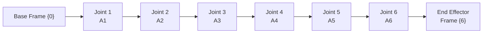

# UR5 Forward Kinematics Using Python

## 1. Project Overview

This project implements the Forward Kinematics of a modified UR5 six-degree-of-freedom (6-DOF) robotic manipulator using Python.

The Standard Denavit-Hartenberg (DH) convention is used to calculate the transformation matrices and determine the end-effector position and orientation.

## 2. Robot Specifications

- Robot: Modified UR5
- Degrees of Freedom: 6
- DH Convention: Standard DH
- Programming Language: Python
- Library: NumPy
- Robot Dimensions: Increased by 5%
- Joint Angles: [30°, 45°, 30°, 20°, 60°, 90°]

## 3. Project Objectives

- Understand the Denavit-Hartenberg convention.
- Calculate individual joint transformation matrices.
- Perform forward kinematics using homogeneous transformation matrices.
- Determine the final end-effector position and orientation.

## 4. Methodology

The forward kinematics equation is:

T = A1 × A2 × A3 × A4 × A5 × A6

Each transformation matrix is calculated using the Standard DH parameters.

Python and NumPy are used for matrix calculations.

## 5. Installation

Install Python and NumPy.

```bash
pip install numpy
```

## 6. How to Run

Run the following command:

```bash
python ur5_forward_kinematics.py
```

## 7. Output

The program displays:

- Six individual transformation matrices.
- Final homogeneous transformation matrix.
- End-effector position in millimetres.

## 8. Technologies Used

- Python
- NumPy
- GitHub

## 9. Applications

- Industrial robotics
- Robotic manipulator design
- Robot kinematics
- Coordinate transformations
- Robotics research and development

## 10. Author

Mechanical Engineering | Robotics Engineering

**Project:** UR5 Forward Kinematics

## 11. Results

The forward kinematics program was executed successfully using Python and NumPy.

### End-Effector Position

| Coordinate | Position |
|---|---:|
| X | -195.291 mm |
| Y | -294.981 mm |
| Z | -685.649 mm |

### Final Transformation Matrix

```text
[[-0.8627 -0.3953  0.3154 -0.1953]
 [-0.4981  0.7718 -0.3953 -0.2950]
 [-0.0872 -0.4981 -0.8627 -0.6856]
 [ 0.0000  0.0000  0.0000  1.0000]]
```

## 12. Robot Kinematic Structure

The following diagram illustrates the six-joint serial manipulator and its coordinate-frame transformation sequence.



### Transformation Sequence

The complete transformation from the base frame to the end-effector frame is:

T06 = A1 × A2 × A3 × A4 × A5 × A6

Each Ai represents the homogeneous transformation between two consecutive coordinate frames.
